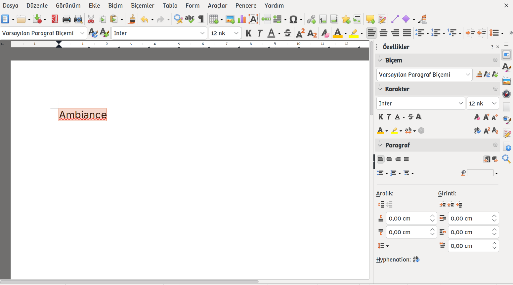
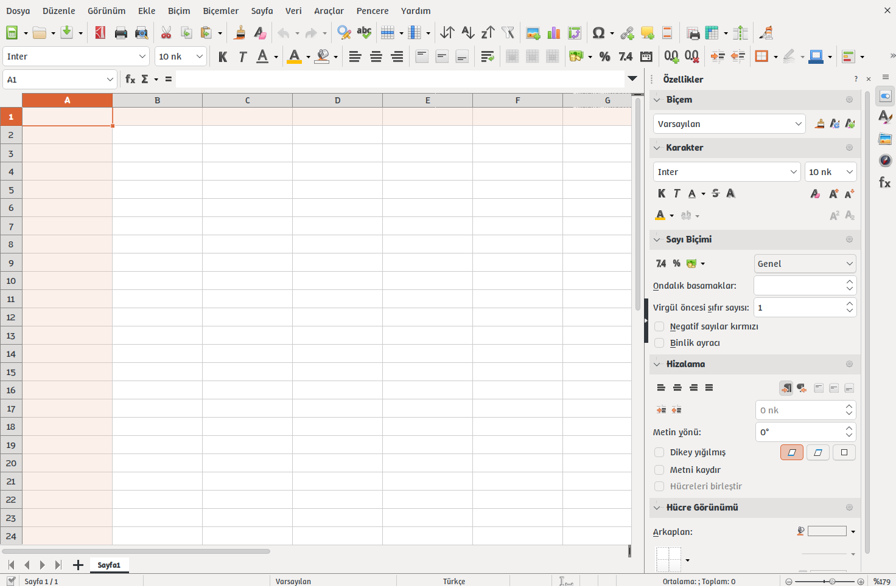

<p align="center">
  
</p>

<p align="center">
  
</p>

<p align="center">
  <a href="#english">English</a> | <a href="#türkçe">Türkçe</a>
</p>

---

## English

# Ambiance - LibreOffice Color Scheme

A LibreOffice **Application Colors** scheme inspired by Ubuntu's Ambiance theme, with a light gray background and an orange accent color.

### Colors

| Item | Color |
|---|---|
| Accent / selected item | `#DC6434` |
| Window and menu background | `#F2F1F0` |
| Text | `#31363B` |

### Requirements

- LibreOffice 7.x or later (the color scheme list is available in these versions)

### Installation

1. Download the latest `Ambiance.oxt` from the [Releases](../../releases) page.
2. Open LibreOffice and go to **Tools > Extension Manager > Add...**, then select the downloaded file.
3. Restart LibreOffice.

To install from the command line (with LibreOffice closed):

```
unopkg add Ambiance.oxt
```

### Usage

Open **Tools > Options > LibreOffice > Appearance** and choose **Ambiance** from the **Themes** list.

### Known limitations

- With Qt/KDE-based UI styles (Breeze, Fusion, etc.), menus, buttons and windows are drawn by the system rather than LibreOffice, so the menu highlight uses the KDE accent color. For an orange highlight, set the accent color to `#DC6434` under **System Settings > Colors & Themes > Colors**.
- The scheme looks most consistent with VCL plugins that use LibreOffice's own drawing layer, such as `gen`.
- The scheme does not change document area colors (grid, text boundaries, etc.); these keep LibreOffice defaults.

### Uninstallation

Select **Ambiance** in **Tools > Extension Manager** and click **Remove**. It is recommended to switch to another color scheme first.

### Credits

This extension was prepared based on the extension structure by [SilverGreen93](https://github.com/SilverGreen93).
### License

MIT License. Based on the work of [SilverGreen93](https://github.com/SilverGreen93). See [LICENSE](LICENSE).

---

## Türkçe

# Ambiance - LibreOffice Renk Şeması

Ubuntu'nun Ambiance temasından esinlenen, açık gri zemin ve turuncu vurgu rengi kullanan bir LibreOffice **Uygulama Renkleri** şemasıdır.

### Renkler

| Öğe | Renk |
|---|---|
| Vurgu / seçili öğe | `#DC6434` |
| Pencere ve menü zemini | `#F2F1F0` |
| Metin | `#31363B` |

### Gereksinimler

- LibreOffice 7.x veya üzeri (renk şeması listesi bu sürümlerde bulunur)

### Kurulum

1. [Releases](../../releases) sayfasından en son `Ambiance.oxt` dosyasını indirin.
2. LibreOffice'i açın ve **Araçlar > Eklenti Yöneticisi > Ekle...** yolunu izleyip indirdiğiniz dosyayı seçin.
3. LibreOffice'i yeniden başlatın.

Komut satırından kurmak isterseniz (LibreOffice kapalıyken):

```
unopkg add Ambiance.oxt
```

### Kullanım

**Araçlar > Seçenekler > LibreOffice > Görünüm** sayfasını açın ve **Temalar** listesinden **Ambiance**'ı seçin.

### Bilinen sınırlamalar

- Qt/KDE tabanlı arayüz stillerinde (Breeze, Fusion vb.) menü, düğme ve pencere renklerini LibreOffice değil sistem çizer. Bu durumda menü vurgusu KDE vurgu rengini kullanır. Turuncu vurgu için **Sistem Ayarları > Renkler ve Temalar > Renkler** bölümünden vurgu rengini `#DC6434` yapabilirsiniz.
- Şema, `gen` gibi LibreOffice'in kendi çizim katmanını kullanan arayüz eklentilerinde en tutarlı görünür.
- Şema, belge alanı renklerini (ızgara, metin sınırları vb.) değiştirmez, bunlar LibreOffice varsayılanlarında kalır.

### Kaldırma

**Araçlar > Eklenti Yöneticisi** bölümünde **Ambiance**'ı seçip **Kaldır** deyin. Önce başka bir renk şeması seçmeniz önerilir.

### Kaynak ve teşekkür

Bu eklenti, [SilverGreen93](https://github.com/SilverGreen93)'ün eklenti yapısından yola çıkılarak hazırlanmıştır.
### Lisans

MIT Lisansı. [SilverGreen93](https://github.com/SilverGreen93)'ün çalışmasına dayanır. Ayrıntılar için [LICENSE](LICENSE) dosyasına bakın.
